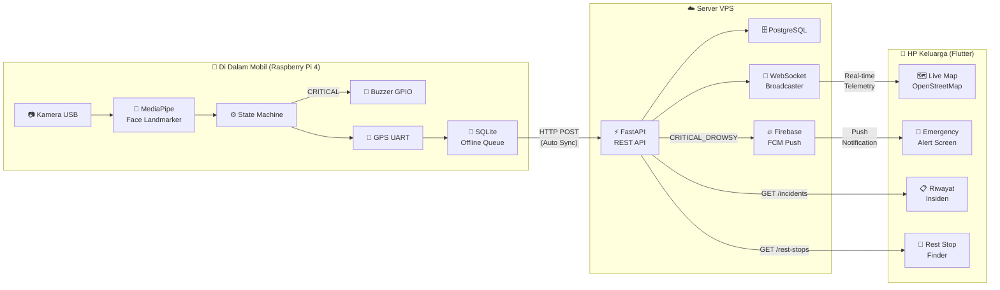
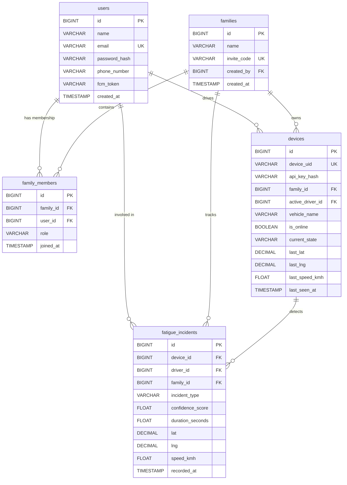

# 📘 Dokumentasi WinFams — Panduan Demonstrasi Lengkap

## Daftar Isi
1. [Apa Itu WinFams?](#1-apa-itu-winfams)
2. [Arsitektur Sistem](#2-arsitektur-sistem)
3. [Tech Stack](#3-tech-stack)
4. [Alur Kerja Sistem (How It Works)](#4-alur-kerja-sistem)
5. [Persiapan Sebelum Demo](#5-persiapan-sebelum-demo)
6. [Skenario Demo Langkah demi Langkah](#6-skenario-demo-langkah-demi-langkah)
7. [Endpoint API Reference](#7-endpoint-api-reference)
8. [Skema Database (ERD)](#8-skema-database-erd)
9. [Konfigurasi & Threshold Kalibrasi](#9-konfigurasi--threshold-kalibrasi)
10. [FAQ & Troubleshooting](#10-faq--troubleshooting)

---

## 1. Apa Itu WinFams?

**WinFams (Window to Family Safety)** adalah sistem keselamatan pengemudi berbasis IoT dan AI yang terdiri dari tiga pilar:

- **Edge AI (Raspberry Pi 4 di Mobil):** Menganalisis wajah pengemudi secara real-time menggunakan kamera dan model AI (MediaPipe Face Landmarker) untuk mendeteksi kantuk (microsleep) dan menguap berlebihan.
- **Backend REST API (Server VPS):** Menerima data telemetri dari mobil, menyimpannya di database PostgreSQL, dan mem-broadcast posisi & status pengemudi ke anggota keluarga secara real-time melalui WebSocket.
- **Aplikasi Mobile (Flutter - HP Keluarga):** Menampilkan peta lokasi kendaraan secara live, memicu alarm darurat saat pengemudi mengantuk, dan menampilkan riwayat insiden serta rekomendasi rest area terdekat.

### Masalah yang Diselesaikan
> Berdasarkan data Korlantas Polri, **microsleep** (mata tertutup selama 1-3 detik) menjadi salah satu penyebab utama kecelakaan lalu lintas fatal di jalan tol dan antar kota. Pada kecepatan 80 km/jam, kendaraan melaju tanpa kendali sejauh **~27 meter** hanya dalam 1,2 detik mata tertutup.

WinFams memberikan **peringatan ganda**:
1. **Peringatan langsung ke pengemudi** melalui buzzer di mobil.
2. **Peringatan langsung ke keluarga** melalui notifikasi darurat di HP, agar keluarga bisa segera menghubungi dan mengingatkan pengemudi.

---

## 2. Arsitektur Sistem



---

## 3. Tech Stack

| Komponen | Teknologi | Alasan Pemilihan |
|----------|-----------|-----------------|
| **Edge AI** | Python 3.10+, MediaPipe Face Landmarker | Model pre-trained ringan, output blendshapes langsung tanpa rumus geometri manual |
| **Kamera** | OpenCV (`cv2.VideoCapture`) | Kompatibel luas, mendukung USB webcam dan CSI camera Pi |
| **State Machine** | Pure Python (timer-based) | Deterministik, bisa di-unit-test tanpa hardware |
| **Hardware I/O** | `gpiozero` (Buzzer), `pyserial` + `pynmea2` (GPS) | Library resmi Raspberry Pi, auto-fallback mock mode |
| **Offline Buffer** | SQLite WAL mode | Ringan, tanpa server, ACID-compliant, cocok untuk embedded |
| **Backend API** | FastAPI + Uvicorn | Async, WebSocket built-in, auto-generate Swagger docs |
| **Database** | PostgreSQL + SQLAlchemy 2.0 | Relational, index Foreign Key, production-grade |
| **Auth** | JWT (python-jose) + Bcrypt | Stateless, aman, standar industri |
| **Real-time** | FastAPI WebSocket | Bi-directional, low-latency, native support |
| **Push Notification** | Firebase Cloud Messaging (FCM) | Gratis, mendukung high-priority background notification |
| **Mobile** | Flutter 3.x + Dart 3.x | Cross-platform, performa native, null-safety |
| **State Management** | Riverpod 3.x | Compile-safe, testable, no context dependency |
| **Peta** | `flutter_map` + OpenStreetMap | Gratis tanpa API key, tile server publik |
| **HTTP Client** | Dio (Flutter), httpx (Python) | Interceptor, retry, timeout built-in |

---

## 4. Alur Kerja Sistem

### A. Alur Deteksi Kantuk (Edge → Buzzer)
1. Kamera mengambil frame video 30 FPS di thread terpisah (non-blocking).
2. Setiap frame diproses oleh **MediaPipe Face Landmarker** yang menghasilkan 478 titik landmark wajah dan 52 blendshape scores.
3. Skor `eyeBlinkLeft` + `eyeBlinkRight` dirata-ratakan → jika **≥ 0.45** selama **≥ 1.2 detik**, status berubah menjadi `CRITICAL_DROWSY`.
4. Skor `jawOpen` → jika **≥ 0.42** selama **≥ 1.8 detik** sebanyak **3 kali dalam 10 menit**, status berubah menjadi `WARNING_FATIGUE`.
5. Buzzer GPIO langsung berbunyi pola darurat (beep cepat berulang) untuk membangunkan pengemudi.

### B. Alur Sinkronisasi ke Server (Edge → API)
1. Setiap 10 detik, Edge mengirim `HeartbeatPayload` (posisi GPS, status, confidence) ke `POST /api/v1/edge/heartbeat`.
2. Saat terjadi insiden, Edge mengirim `IncidentPayload` ke `POST /api/v1/edge/incidents`.
3. Jika internet terputus (blank spot), data disimpan ke **SQLite offline queue**. Saat sinyal kembali, data otomatis dikirim (*auto-flush*).

### C. Alur Notifikasi ke Keluarga (API → Mobile)
1. API menyimpan insiden ke PostgreSQL dan langsung mem-broadcast via **WebSocket** ke semua HP keluarga yang sedang membuka Live Map.
2. Untuk HP keluarga yang sedang tidak membuka aplikasi, API mengirim **FCM Push Notification** prioritas tinggi sehingga HP berbunyi alarm walaupun layar mati.
3. Di HP keluarga, layar Emergency Alert menampilkan: lokasi pengemudi di peta, kecepatan kendaraan, tingkat keyakinan kantuk, dan tombol **"Hubungi Pengemudi"** (langsung telepon).

---

## 5. Persiapan Sebelum Demo

### A. Pastikan Semua Service Aktif

| Service | Cara Verifikasi | Output yang Diharapkan |
|---------|----------------|----------------------|
| **API di VPS** | Buka browser: `https://api.pemasukan.me/docs` | Halaman Swagger UI terbuka |
| **Database PostgreSQL** | Di VPS: `sudo systemctl status postgresql` | `active (running)` |
| **Systemd Service** | Di VPS: `sudo systemctl status winfams-api` | `active (running)` |

### B. Perangkat yang Dibutuhkan untuk Demo

| Perangkat | Fungsi | Keterangan |
|-----------|--------|-----------|
| **Laptop / Raspberry Pi 4** | Menjalankan Edge AI + Webcam | Pastikan webcam terdeteksi |
| **HP Android** | Menjalankan Aplikasi WinFams Mobile | Sudah terinstall APK atau via `flutter run` |
| **Koneksi Internet** | Menghubungkan Edge dan Mobile ke VPS | Wi-Fi atau mobile data |

### C. Jalankan Edge Monitor

**Di Laptop (Windows PowerShell):**
```powershell
$env:WINFAMS_API_BASE_URL="https://api.pemasukan.me"
$env:WINFAMS_DEVICE_UID="pi4_car_01"
$env:WINFAMS_DEVICE_API_KEY="dev_api_key_secret_123"
python winfams-edge/main.py --preview --no-sync
```

**Di Raspberry Pi 4 (Bash):**
```bash
export WINFAMS_API_BASE_URL="https://api.pemasukan.me"
export WINFAMS_DEVICE_UID="pi4_car_01"
export WINFAMS_DEVICE_API_KEY="dev_api_key_secret_123"
python winfams-edge/main.py
```

> **Flag yang tersedia:**
> - `--preview` → Tampilkan jendela OpenCV dengan HUD analitik wajah
> - `--web --port 8080` → Aktifkan dashboard web di `http://localhost:8080`
> - `--mock` → Gunakan mock hardware (tanpa GPIO/GPS fisik)
> - `--no-sync` → Nonaktifkan pengiriman data ke server (demo offline)

---

## 6. Skenario Demo Langkah demi Langkah

### 🎬 Demo 1: Deteksi Microsleep → Alarm Darurat

**Tujuan:** Menunjukkan bahwa sistem mampu mendeteksi mata tertutup dan membunyikan alarm.

| Langkah | Aksi | Hasil yang Diharapkan |
|---------|------|----------------------|
| 1 | Jalankan Edge dengan `--preview` | Jendela OpenCV muncul dengan HUD: kotak wajah, kontur mata, bar indikator |
| 2 | Duduk normal di depan kamera, mata terbuka | Status: **NORMAL** (badge hijau), bar Eye Closure rendah (< 10%) |
| 3 | **Pejamkan mata selama 1-2 detik** | Bar Eye Closure naik melewati garis threshold merah |
| 4 | Tetap pejamkan mata > 1.2 detik | Status berubah: **CRITICAL_DROWSY** (badge merah), **buzzer berbunyi beep cepat** |
| 5 | Buka mata kembali | Status kembali: **NORMAL**, buzzer berhenti |

### 🎬 Demo 2: Deteksi Menguap Berulang → Peringatan Kelelahan

**Tujuan:** Menunjukkan bahwa sistem mendeteksi pola menguap berulang (bukan sekali saja).

| Langkah | Aksi | Hasil yang Diharapkan |
|---------|------|----------------------|
| 1 | Menguap lebar (buka mulut) selama ≥ 1.8 detik | Bar Yawn Score naik, log menunjukkan "Qualifying yawn recorded" |
| 2 | Ulangi menguap 3 kali dalam 10 menit | Yawn counter bertambah: 1 → 2 → 3 |
| 3 | Setelah kuap ke-3 melampaui durasi | Status berubah: **WARNING_FATIGUE** (badge kuning), **buzzer berbunyi pola lambat** |

### 🎬 Demo 3: Sinkronisasi Real-time ke Server + Notifikasi HP Keluarga

**Tujuan:** Menunjukkan data insiden langsung terkirim ke server dan muncul di HP keluarga.

| Langkah | Aksi | Hasil yang Diharapkan |
|---------|------|----------------------|
| 1 | Buka Swagger UI: `https://api.pemasukan.me/docs` | Dokumentasi API interaktif terbuka |
| 2 | Jalankan Edge **tanpa** `--no-sync` | Edge mulai mengirim heartbeat setiap 10 detik |
| 3 | Di HP, buka aplikasi WinFams → Login → Live Map | Peta menampilkan pin kendaraan bergerak |
| 4 | Di depan kamera, pejamkan mata > 1.2 detik | Insiden terkirim → HP keluarga langsung menampilkan **layar merah darurat** + suara alarm |
| 5 | Di HP, tekan tombol **"Hubungi Pengemudi"** | Aplikasi membuka dialer telepon ke nomor pengemudi |

### 🎬 Demo 4: Ketahanan Offline (Resilience)

**Tujuan:** Menunjukkan bahwa sistem tetap berfungsi meskipun internet terputus.

| Langkah | Aksi | Hasil yang Diharapkan |
|---------|------|----------------------|
| 1 | Cabut koneksi internet laptop/Pi | Log: "Network unreachable, buffering to SQLite" |
| 2 | Pejamkan mata > 1.2 detik | **Buzzer tetap berbunyi!** (deteksi dan alarm tidak bergantung internet) |
| 3 | Data insiden tersimpan ke SQLite lokal | Log: "Incident queued to offline cache" |
| 4 | Hubungkan kembali internet | Log: "Flushing offline queue..." → data terkirim ke server |

### 🎬 Demo 5: Dashboard Web Monitoring

**Tujuan:** Menunjukkan tampilan monitoring via browser.

| Langkah | Aksi | Hasil yang Diharapkan |
|---------|------|----------------------|
| 1 | Jalankan Edge dengan `--web --port 8080` | Server web lokal aktif di port 8080 |
| 2 | Buka browser: `http://localhost:8080` | Dashboard menampilkan live video stream (MJPEG) + telemetri real-time |
| 3 | Pejamkan mata di depan kamera | Status di dashboard langsung berubah merah: CRITICAL_DROWSY |

---

## 7. Endpoint API Reference

### Autentikasi & Manajemen Keluarga (Diakses oleh Aplikasi Flutter)

| Method | Endpoint | Deskripsi |
|--------|----------|-----------|
| `POST` | `/api/v1/auth/register` | Registrasi akun pengguna baru |
| `POST` | `/api/v1/auth/login` | Login dan mendapatkan JWT token |
| `GET` | `/api/v1/auth/me` | Mendapatkan profil user yang sedang login |
| `PUT` | `/api/v1/auth/fcm-token` | Memperbarui token FCM untuk push notification |
| `POST` | `/api/v1/families` | Membuat grup keluarga baru (auto-generate invite code) |
| `POST` | `/api/v1/families/join` | Bergabung ke keluarga menggunakan invite code |
| `GET` | `/api/v1/families/{id}/overview` | Mengambil ringkasan keluarga, anggota, dan kendaraan |
| `POST` | `/api/v1/families/{id}/devices` | Mendaftarkan perangkat Raspberry Pi ke keluarga |

### Telemetri IoT Edge (Diakses oleh Raspberry Pi dengan `X-Device-API-Key`)

| Method | Endpoint | Deskripsi |
|--------|----------|-----------|
| `POST` | `/api/v1/edge/heartbeat` | Update posisi GPS, kecepatan, dan status pengemudi (setiap 10 detik) |
| `POST` | `/api/v1/edge/incidents` | Melaporkan insiden kantuk/menguap yang terdeteksi |

### Monitoring & Riwayat (Diakses oleh Flutter)

| Method | Endpoint | Deskripsi |
|--------|----------|-----------|
| `GET` | `/api/v1/families/{id}/incidents` | Daftar riwayat insiden kantuk (filter by type) |
| `WS` | `/ws/families/{family_id}?token={jwt}` | WebSocket real-time untuk Live Map |

### Contoh Payload

**HeartbeatPayload (Edge → Server):**
```json
{
  "device_uid": "pi4_car_01",
  "state": "DRIVING",
  "drowsy_confidence": 0.12,
  "yawn_confidence": 0.05,
  "location": {
    "lat": -1.265386,
    "lng": 116.831200,
    "speed_kmh": 64.5
  },
  "timestamp": 1730334600
}
```

**IncidentPayload (Edge → Server saat CRITICAL_DROWSY):**
```json
{
  "device_uid": "pi4_car_01",
  "incident_type": "CRITICAL_DROWSY",
  "confidence_score": 0.88,
  "duration_seconds": 2.1,
  "location": {
    "lat": -1.265386,
    "lng": 116.831200,
    "speed_kmh": 72.0
  },
  "recorded_at": 1730334605
}
```

---

## 8. Skema Database (ERD)



---

## 9. Konfigurasi & Threshold Kalibrasi

Semua threshold telah dikalibrasi berdasarkan riset empiris medis dan standar NHTSA/PERCLOS:

| Parameter | Nilai | Alasan / Standar |
|-----------|-------|-----------------|
| `BLINK_THRESHOLD` | **0.45** | MediaPipe blendshape: mata normal terbuka = 0.00–0.08, kantuk alami = 0.38–0.48 |
| `DROWSY_TIME_SEC` | **1.2 detik** | Standar PERCLOS/NHTSA: pada 80 km/jam = kendaraan melaju ~27m tanpa kendali |
| `YAWN_THRESHOLD` | **0.42** | `jawOpen` bicara normal < 0.25, menguap alami = 0.40–0.48 |
| `YAWN_TIME_SEC` | **1.8 detik** | Durasi menguap spontan rata-rata saat mengemudi |
| `YAWN_COUNT_TRIGGER` | **3 kali** | 3 kuap dalam 10 menit mengindikasikan kelelahan akumulatif |
| `YAWN_WINDOW_SEC` | **600 detik** | Jendela waktu sliding 10 menit untuk akumulasi kuap |

Konfigurasi dapat diubah melalui environment variable atau file `winfams-edge/config/settings.py`.

---

## 10. FAQ & Troubleshooting

### Q: Apakah sistem tetap bekerja tanpa internet?
**Ya.** Deteksi kantuk dan alarm buzzer berjalan 100% lokal di Raspberry Pi. Data insiden akan disimpan ke SQLite lokal dan otomatis dikirim ke server saat internet tersambung kembali.

### Q: Apakah sistem bisa berjalan di laptop biasa (tanpa Raspberry Pi)?
**Ya.** Semua hardware (Buzzer dan GPS) memiliki mock mode otomatis. Di laptop Windows, buzzer diganti dengan suara `winsound.Beep()` melalui speaker laptop. Jalankan dengan flag `--mock`.

### Q: Berapa FPS yang dihasilkan di Raspberry Pi 4?
Dengan MediaPipe Face Landmarker (float16), Raspberry Pi 4 (4GB RAM) menghasilkan sekitar **8-15 FPS**, cukup untuk deteksi kantuk real-time. Di laptop modern, bisa mencapai **25-30 FPS**.

### Q: Bagaimana jika API server mati / VPS restart?
Service `winfams-api` sudah didaftarkan sebagai systemd service (`winfams-api.service`) dengan konfigurasi `Restart=always`. Jika server VPS di-restart, API akan otomatis menyala kembali dalam 3 detik.

### Q: Bagaimana cara menambahkan anggota keluarga baru?
1. Pembuat keluarga melihat **invite code** di halaman Family Hub.
2. Anggota baru membuka aplikasi → Register → Gabung Keluarga → masukkan invite code.
3. Anggota langsung terhubung dan bisa memantau lokasi & status pengemudi di Live Map.

### Q: Error 502 Bad Gateway di browser?
Periksa apakah service API berjalan: `sudo systemctl status winfams-api`. Jika statusnya `failed`, lihat log error: `sudo journalctl -u winfams-api -n 20 --no-pager`. Penyebab umum: library belum terinstall, password database salah, atau port bentrok.

### Q: Buzzer tidak berbunyi di Raspberry Pi?
1. Pastikan buzzer terpasang di **GPIO BCM 17 (Pin Fisik 11)**, bukan Pin Fisik 17 (yang merupakan 3.3V power).
2. Pastikan menggunakan **Active Buzzer** (bukan Passive Buzzer yang membutuhkan sinyal PWM).
3. Jika modul buzzer bertipe **Active-Low**, set environment variable: `WINFAMS_BUZZER_ACTIVE_HIGH=false`.

---

## Hasil Pengujian Sistem

| Komponen | Suite Pengujian | Hasil | Detail |
|----------|----------------|-------|--------|
| `winfams-edge` | `pytest winfams-edge/tests/ -v` | **54/54 passed** | Camera, MediaPipe, State Machine, Buzzer, GPS, SQLite Cache, Cloud Sync, Visualizer |
| `winfams-api` | `pytest winfams-api/tests/ -v` | **15/15 passed** | SQLAlchemy Models, Auth JWT, Family Pairing, Telemetry Ingestion, WebSocket, FCM |
| `winfams-mobile` | `flutter test` | **37/37 passed** | Riverpod Providers, Auth Gate, Live Map, Emergency Alert, Incident History, Rest Stop |
| `winfams-mobile` | `flutter analyze` | **0 issues** | No errors, no warnings |
| Semua file | Batas ≤ 250 baris/file | **100% patuh** | Tidak ada file yang melebihi 250 baris kode |

